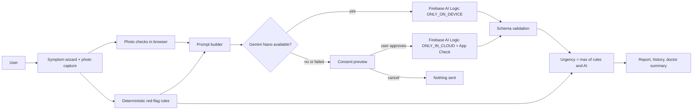

# EyeCheck Assistant

**Private, AI-assisted preliminary eye screening.** Gemini Nano analyzes eye photos and symptoms on the user's own device. Cloud Gemini is used only after the user reviews exactly what would be sent and approves it. Built on Firebase AI Logic hybrid inference for the #BuildHybridAI 2026 hackathon.

**Live demo:** https://mohamedelhamady213-collab.github.io/eyecheck-assistant/

> EyeCheck is a screening aid, not a medical device. It does not diagnose, it has not been clinically validated, and it makes no accuracy claims. See [Limitations](#limitations-and-responsible-ai).

## Problem

People with eye symptoms often do not know how quickly they need care, and many search the web or upload photos to tools whose data handling is unclear. Eye photos and symptom descriptions are sensitive health data.

## Solution

A guided flow that keeps the sensitive part on the device:

1. **Guided capture.** Instructions for distance and lighting, camera or upload, and automatic photo checks (format, size, resolution, sharpness, lighting, glare, face/eye position where the browser supports it).
2. **Symptom check.** Eleven short questions in English or Arabic plus optional free text.
3. **Deterministic red-flag rules.** Plain code, not an LLM, decides when symptoms look urgent or like an emergency (sudden vision loss, chemical or injury exposure, flashes with blur, severe pain with redness, and similar). The banner appears the moment such an answer is given. The AI can raise but never lower this level.
4. **On-device AI.** Gemini Nano (Firebase AI Logic `ONLY_ON_DEVICE`) describes visible features and summarizes symptoms as structured JSON.
5. **Consent-gated cloud.** If Nano is unavailable or fails, the app says so, shows the exact payload (photos and text), and sends nothing unless the user ticks a confirmation and presses send. There is no automatic fallback.
6. **Report.** Urgency, photo quality, per-eye AI observations (labelled as not confirmed findings), what can and cannot be assessed from a photo, next steps, limitations, a doctor-ready summary, and a print-to-PDF layout (works in Arabic).
7. **Timeline and privacy center.** Optional history with comparison, a log of every cloud request made in the tab, and one-click deletion.

## Why hybrid inference matters here

Privacy is the default path, not a setting: the on-device model handles raw photos and symptom text, so most sessions never leave the browser. The cloud model exists for devices that cannot run Nano, but it is opt-in per request and only after a preview. Hybrid inference lets one codebase offer both without a silent privacy downgrade.

## Architecture



| Module | Role |
| --- | --- |
| `src/safety.js` | Deterministic triage from answers and free text (English and Arabic), with negation handling |
| `src/symptoms.js` | Question definitions, validation, sanitizing, summary |
| `src/imagequality.js` | File validation, resize, sharpness/lighting/glare checks |
| `src/ai.js` | Prompt, strict JSON validation, consent-gated orchestration |
| `src/engines.js`, `src/firebase.js` | Firebase AI Logic models, App Check, cloud model fallback |
| `src/history.js` | Tab-only history by default, 30-day device storage only with consent |
| `src/report.js` | Doctor-ready summary |
| `src/i18n.js` | English and Arabic strings, RTL |
| `src/main.js` | UI wiring (safe DOM rendering only, no `innerHTML` on user or model text) |

## Privacy and security

- No accounts, analytics, or advertising trackers. No API secrets in the code: the Firebase web config and reCAPTCHA site key are public identifiers.
- **Firebase App Check** (reCAPTCHA Enterprise) is enforced on the project. This is the one thing that contacts Google on page load, and it does not receive photos or answers. The debug token is only honored on `localhost` and is not in the public build.
- Photos are never stored. History keeps a 96 px thumbnail and the report only, in the tab (`sessionStorage`) unless the user opts in to 30-day device storage.
- Model output is validated: wrong shape is rejected, invented percentages are dropped, HTML is stripped, and nothing is fabricated for missing fields.
- A Content Security Policy limits scripts to this origin and Google's reCAPTCHA hosts.
- No database or backend storage is used, so no Firebase security rules are needed for user data.

## Limitations and responsible AI

- Not a diagnosis. Not clinically validated. No accuracy, sensitivity, or user numbers are claimed.
- An external photo cannot show the retina or optic nerve. Glaucoma, diabetic retinopathy, macular degeneration and retinal detachment are always shown as **not assessable**, and cataract as **limited**. These rows are fixed by the app and are not chosen by the model.
- The red-flag rules are conservative and based on commonly published warning signs. **They have not been reviewed by a clinician** and can miss cases or over-warn.
- The photo checks are heuristics about the picture, not about the eye. A "good" photo does not make the AI result accurate.
- Poor photo quality blocks any reassuring wording in the report.
- Differences between two reports in the timeline do not show improvement or worsening.
- On-device AI requires a Chrome version with the Prompt API and a downloaded Gemini Nano model. Face/eye position checks use the browser's `FaceDetector` only when available.
- Voice input is not included: browser speech recognition sends audio to a cloud service, which would break the privacy claim.

## Technology

Firebase AI Logic (hybrid inference, `firebase/ai`), Gemini Nano via Chrome's Prompt API, Gemini in the cloud (`gemini-3.8-flash`, fallback `gemini-3.5-flash-lite`), Firebase App Check with reCAPTCHA Enterprise, Vite, plain JavaScript, `node:test` and Puppeteer for tests. Apache-2.0.

## Install and run

```bash
npm install
cp .env.example .env   # fill in your Firebase web config and reCAPTCHA Enterprise key
npm run dev
```

For `localhost`, create an App Check debug token in the Firebase console and set `VITE_APPCHECK_DEBUG_TOKEN` in `.env`. Never commit `.env`.

Firebase setup: enable Firebase AI Logic (Gemini Developer API), register the web app, create a reCAPTCHA Enterprise key for your domains, and enforce App Check.

## Tests

```bash
npm test                          # unit tests (safety rules, validation, image checks, history, i18n, consent logic)
npm run build:test && npm run test:e2e   # browser tests in headless Chrome against a mocked-AI build
```

The end-to-end build swaps `src/firebase.js` for `src/firebase.mock.js` so every branch (Nano unavailable, init failure, invalid JSON, consent cancel and approve) can run without network. The mock exists only in the test build. Live behavior against real Firebase and Gemini was checked by hand with sample data only.

## Demo walkthrough

1. Open the live site and choose **Start screening**.
2. Upload a right-eye and a left-eye photo (use a sample photo, not a real patient). Review the automatic photo checks.
3. Answer the symptom questions. Try answering "Yes" to sudden vision loss to see the emergency banner appear immediately.
4. Review the answers and press **Run on-device screening**. In Chrome with Gemini Nano the badge reads "Analyzed on-device (Gemini Nano)".
5. In a browser without Nano, see the consent preview with the exact payload. Cancel keeps everything private. Approving sends one cloud request, which is added to the log in the Privacy center.
6. Read the report, open the **Doctor summary**, and use **Print / save as PDF**.
7. Run a second screening, open **History**, compare the two, and delete them from the Privacy center.
8. Switch to Arabic with the language button (right-to-left layout, Arabic questions and report).

## Deployment

GitHub Actions (`.github/workflows/pages.yml`) runs the unit tests, builds with Vite and deploys to GitHub Pages.

## License

Apache-2.0
